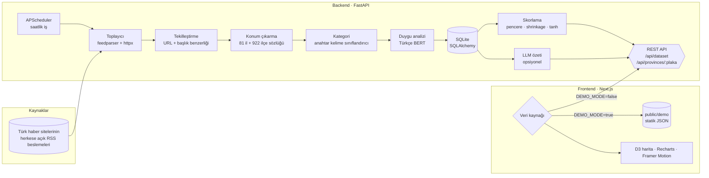

<div align="center">

# Türkiye Nabzı

**Türkiye'deki haberleri yapay zekâ ile okuyup 81 ilin duygu tonunu canlı bir harita üzerinde gösteren gösterge paneli.**

[Canlı demo](https://LINK-BURAYA.vercel.app) · [API dokümantasyonu](http://localhost:8000/docs) · [Nasıl çalışır?](#ai-hattı-nasıl-çalışır)


<!-- Ekran görüntüsü / GIF: docs/demo.gif dosyasını ekleyip aşağıdaki satırı açın -->
<!--  -->
`[ ekran görüntüsü / GIF buraya ]`

</div>

---

## Özellikler

- **Duygu haritası:** 81 il, Türkiye ortalamasına göre göreceli duygu skoruna göre renkleniyor (mercan → gri-mor → zümrüt). Az haberi olan iller çapraz taralı desenle "yetersiz veri" olarak gösteriliyor.
- **Etkileşim:** Üzerine gelinen il yükselip parlıyor ve imlecin yanında skor ile haber sayısını gösteren bir tooltip açılıyor. Tıklanan il için masaüstünde sağdan bir detay paneli, mobilde alttan sürüklenebilir bir sheet açılıyor.
- **Zaman yolculuğu:** 30 günlük kaydırıcı ve *oynat* butonu. Harita günden güne 600 ms'lik renk geçişleriyle canlanıyor.
- **Kategori filtresi:** Tümü, Ekonomi, Spor, Asayiş, Kültür-Sanat, Eğitim, Sağlık ve Hava-Çevre.
- **İl detayı:** Skor, haber sayısı, sıralama, 30 günlük trend, kategori dağılımı, kelime bulutu, kaynak linkli son 5 başlık ve opsiyonel AI özeti ("Bugün öne çıkanlar").
- **Karşılaştırma:** İki ilin trendini aynı grafikte görme.
- **Sıralama:** En olumlu ve en olumsuz 5 il, değiştikçe animasyonla yeniden diziliyor.
- **Ruh hali göstergesi:** "Türkiye'nin bugünkü ruh hali" endeksi, ibreli bir gösterge ve günlük değişim yüzdesiyle birlikte.
- **Demo modu:** Backend olmadan, gerçekçi 30 günlük sentetik veriyle Vercel'de tek başına çalışıyor.

## Mimari



Frontend, demo verisini ve canlı API'yi aynı `DataSource` arayüzü üzerinden okuyor. Demo üreticisi ile backend aynı veri sözleşmesini ([`frontend/src/lib/types.ts`](frontend/src/lib/types.ts)) ve aynı skor formülünü kullandığı için iki mod birebir aynı şekilde görüntüleniyor.

## Kurulum

### Docker ile (tek komut)

```bash
cp .env.example .env     # isteğe bağlı: ANTHROPIC_API_KEY ekleyin
docker compose up --build
```

- Arayüz: http://localhost:3000
- API dokümantasyonu: http://localhost:8000/docs

İlk toplama, sunucu açıldıktan birkaç saniye sonra başlıyor; sonrası saatlik. Duygu modeli (~450 MB) ilk çalıştırmada indirilip `hf-cache` volume'unda saklanıyor. Daha küçük bir imaj için `INSTALL_ML=false docker compose up --build` kullanabilirsiniz; bu durumda duygu analizi anahtar kelime sözlüğüyle yapılıyor.

### Elle kurulum

**Backend** (Python 3.11+)

```bash
cd backend
python -m venv .venv && source .venv/bin/activate   # Windows: .venv\Scripts\activate
pip install -r requirements-dev.txt
pip install -r requirements-ml.txt                  # Türkçe BERT için (opsiyonel)
uvicorn app.main:app --reload
```

Yardımcı komutlar:

```bash
python -m app.cli ingest                                # beslemeleri hemen bir kez çek
python -m app.cli locate "Ordu'da fındık hasadı başladı"  # konum çıkarmayı dene → 52
pytest                                                  # birim ve entegrasyon testleri
```

**Frontend** (Node 20+)

```bash
cd frontend
cp .env.example .env.local    # NEXT_PUBLIC_DEMO_MODE=true → backend gerekmez
npm install
npm run dev
```

### Vercel'e demo olarak yayınlama

Root Directory'yi `frontend` olarak seçin ve `NEXT_PUBLIC_DEMO_MODE=true` ortam değişkenini ekleyin. Demo verisini yenilemek için:

```bash
npm run demo:data -- --seed=42 --end=2026-10-20
```

## AI hattı nasıl çalışır?

1. **Toplama:** [`backend/config/sources.yaml`](backend/config/sources.yaml) dosyasındaki RSS beslemeleri saatlik olarak çekiliyor. Kaynak eklemek için listeye bir satır eklemek yeterli. Yalnızca başlık, kısa özet ve kaynak linki saklanıyor.
2. **Tekilleştirme:** URL'ler normalize ediliyor (`utm_*` gibi parametreler, `www` ve sondaki `/` atılıyor). Başlıklar Türkçe karakterlerden arındırılıp karşılaştırılıyor; son 3 gündeki başlıklarla kelime örtüşmesi (Jaccard ≥ 0,85) veya karakter benzerliği (≥ 0,90) yüksek olan haber kopya sayılıyor.
3. **Konum çıkarma:** 81 il ve 922 ilçeden oluşan bir sözlük kullanılıyor ([kaynak](https://github.com/snrylmz/il-ilce-json)).
   - Kesme işaretinden sonraki ek ayrıştırılıyor: *Ankara'da*, *İzmir'in*, *Yozgat'tan*.
   - Kesmesiz türetmeler de tanınıyor: *Trabzonlu*, *İzmirliler*.
   - İlçe geçen haber bağlı olduğu ile atanıyor. *Gölbaşı* gibi birden fazla ilde bulunan ilçeler ancak il adıyla birlikte geçerse sayılıyor.
   - Başlıktaki eşleşmeler 1,5 kat ağırlık alıyor; eşitlik olursa haber hiçbir ile atanmıyor.
   - *Ordu*, *Batman*, *Van*, *Aydın*, *Mersin*, *Tokat* gibi genel kelime ya da kişi adı olarak da geçebilen isimler için bağlam kuralları var. Örneğin *"Türk Ordusu"*, *"Batman filmi"*, *"Van Gogh"*, *"Ahmet Aydın"* ve *"mersin balığı"* elenirken *"Van Gölü"*, *"Ordu Büyükşehir"* ve *"Aydın'da"* kabul ediliyor.
4. **Duygu analizi:** Başlık ve özet [`savasy/bert-base-turkish-sentiment-cased`](https://huggingface.co/savasy/bert-base-turkish-sentiment-cased) modelinden geçiriliyor; skor `P(olumlu) − P(olumsuz)` ile [−1, +1] aralığına düşüyor. `transformers` kurulu değilse sistem otomatik olarak Türkçe anahtar kelime sözlüğüne geçiyor.
5. **Kategori:** Türkçe'ye duyarlı (*kaza* ≠ *kazandı*, *zam* ≠ *zaman*) bir anahtar kelime sınıflandırıcısı kullanılıyor. `Categorizer` arayüzü sayesinde ileride kod değiştirmeden zero-shot bir modelle değiştirilebilir.
6. **Normalizasyon:** Haberler doğası gereği olumsuz olduğu için iller mutlak değil, Türkiye ortalamasına göre puanlanıyor:

   ```
   pencere  = son 3 gün               (ham_ort, n)
   büzülmüş = (ham_ort·n + türkiye_ort·4) / (n + 4)
   skor     = tanh((büzülmüş − türkiye_ort) / 0.2)    ∈ [−1, +1]
   ```

   Büzüştürme (shrinkage), az haberi olan illerin uç değerlere sıçramasını önlüyor. 5'ten az haberi olan iller "yetersiz veri" olarak işaretleniyor.
7. **Opsiyonel özet:** `.env` dosyasında `ANTHROPIC_API_KEY` varsa, gün içinde en az 5 haberi olan iller için 2-3 cümlelik "bugün öne çıkanlar" özeti Claude ile üretilip günlük önbelleğe alınıyor. Anahtar yoksa özellik sessizce kapalı kalıyor ve arayüzde bu bölüm gösterilmiyor.

## Testler

```bash
cd backend && pytest
```

47 test şunları kapsıyor:

- **Konum çıkarma:** ekler, ilçeler, ASCII yazımlar, aynı adlı ilçeler ve belirsiz isimler
- **Skor hesabı:** pencere, shrinkage, sınırlar ve yetersiz veri
- **Tekilleştirme**
- **Türkçe kelime çakışmaları**
- **Uçtan uca:** RSS öğeleri → veritabanı → API çıktısı

## Bilinen sınırlamalar

- **RSS kapsamı:** Ulusal beslemeler büyük şehirlere ağırlık veriyor. Küçük iller için daha fazla yerel kaynak eklemek gerekiyor.
- **Duygu ≠ olay:** Model haberin *dilini* ölçüyor. "Kaza sonrası mucize kurtuluş" gibi karışık tonlu başlıklar yanlış etiketlenebiliyor ve ikili (olumlu/olumsuz) model nötr tonu iyi ayırt edemiyor.
- **Tek ile atama:** Birden fazla ilden bahseden bir haber yalnızca en güçlü eşleşen ile atanıyor. Haberlerin yaklaşık %40'ı hiçbir ile atanamıyor; bunlar ulusal ve dış haberler.
- **Konum sözlüğü:** Mahalle ve semt adları (ör. *Ayazağa*) sözlükte yok.
- **Ölçek:** SQLite ve bellek içi önbellek tek sunucu için tasarlandı. SQLAlchemy kullanıldığı için PostgreSQL'e geçiş sadece `DATABASE_URL` değişikliği gerektiriyor.
- **Demo verisi:** Demo modundaki tüm haberler, başlıklar ve kaynak adları sentetik. Linkler `example.com`'a gidiyor.

## Yol haritası

- [ ] Zero-shot (XLM-R / NLI) kategori sınıflandırıcısı
- [ ] Üç sınıflı (olumlu / nötr / olumsuz) Türkçe duygu modeline geçiş
- [ ] Birden fazla ile ağırlıklı atama ve mahalle düzeyinde gazetteer
- [ ] Yerel haber sitelerinden il bazlı RSS kaynakları
- [ ] PostgreSQL + Alembic migration'ları, Redis önbellek
- [ ] Haftalık "ruh hali raporu" paylaşım kartı (OG image)
- [ ] İlçe düzeyinde harita

## Proje yapısı

```
├── frontend/                 Next.js 16 · App Router · Tailwind 4
│   ├── scripts/              demo veri üreticisi, GeoJSON hazırlayıcı
│   ├── public/demo/          statik demo veri seti
│   ├── public/geo/           81 il GeoJSON (plaka kodlu)
│   └── src/
│       ├── components/       map · detail · controls · ranking · layout · ui
│       ├── hooks/            veri, şekil ve medya sorgusu hook'ları
│       └── lib/              tipler, renk skalası, seçiciler, veri kaynağı
├── backend/
│   ├── app/
│   │   ├── pipeline/         fetcher · dedupe · locator · categorizer · sentiment · summarizer
│   │   ├── scoring.py        göreceli il skoru
│   │   ├── services.py       veri seti, il detayı, toplama
│   │   └── api.py            FastAPI rotaları
│   ├── config/sources.yaml   RSS kaynak listesi
│   └── tests/
└── docker-compose.yml
```

## Veri ve lisans notları

- İl sınırları: [cihadturhan/tr-geojson](https://github.com/cihadturhan/tr-geojson)
- İl ve ilçe listesi: [snrylmz/il-ilce-json](https://github.com/snrylmz/il-ilce-json)
- Haber içerikleri ilgili yayıncılara aittir. Uygulama yalnızca başlık, kısa özet ve kaynağa giden linki gösteriyor.
